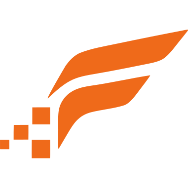

<p align="center">
  <a href="https://flightbyte.dev">
    <picture>
      <source media="(prefers-color-scheme: dark)" srcset="assets/logo-dark.svg">
      
    </picture>
  </a>
</p>

<h3 align="center">FlightByte webhook examples</h3>

<p align="center">
  Receive signed flight webhooks the right way.<br>
  Reference receivers in Node.js, Python and Go, a sender that signs test events,<br>
  and two n8n templates. No dependencies, and no API key needed to try them.
</p>

<p align="center">
  
  
  
  
  
  <a href="LICENSE"></a>
</p>

<p align="center">
  <a href="https://flightbyte.dev/docs/webhooks"><b>Webhook docs</b></a> ·
  <a href="https://flightbyte.dev/guides/verifying-webhook-signatures"><b>Verifying signatures</b></a> ·
  <a href="https://flightbyte.dev/guides/flight-change-alerts-n8n"><b>n8n guide</b></a> ·
  <a href="https://flightbyte.dev/get-api-key?plan=free&utm_source=github&utm_medium=readme&utm_campaign=webhook-examples"><b>Get a free key</b></a> ·
  <a href="https://t.me/flightbyte"><b>Support</b></a>
</p>

---

## Try it in a minute

You don't need an account. The sender signs a real-shaped event with any secret you choose, the same way FlightByte does.

```bash
export FLIGHTBYTE_WEBHOOK_SECRET=whsec_try_it_locally
node node/receiver.mjs
```

In a second terminal:

```bash
export FLIGHTBYTE_WEBHOOK_SECRET=whsec_try_it_locally
node scripts/send-test-event.mjs http://localhost:4599/hooks/flights
```

The sender prints `204 No Content in 27ms`, and the receiver logs what changed:

```text
receiving FlightByte webhooks on http://localhost:4599
[flight.updated] TK1848:2026-09-12@ATH-IST attempt 1 booking BK-1042
  departure.gate.changed: Departure gate changed from A11 to A22
  arrival.estimated.changed: Arrival estimated gate time changed from 2026-09-12T10:45:00Z to 2026-09-12T11:15:00Z
```

## Pick your language

| | Start it | Needs |
| --- | --- | --- |
| **Node.js** | `node node/receiver.mjs` | Node.js 20+ |
| **Python** | `python3 python/receiver.py` | Python 3.11+ |
| **Go** | `go run -C go .` | Go 1.22+ |
| **n8n** | Import a file from [`n8n/workflows/`](n8n/workflows) | n8n 2.x |

The three receivers listen on port `4599` (set `PORT` to change it), accept `POST` on any path, and print the same lines. Each is one file that uses only its language's standard library, so you can copy it into your own service.

## What a receiver has to get right

Every receiver here does four things, in this order:

1. **It verifies the signature** against the raw request body, before any JSON parsing, in constant time, and refuses timestamps more than five minutes old.
2. **It deduplicates on the event id.** A retry carries the same id and the same body, so it gets a `204` and is not handled again.
3. **It answers `204` before doing the work.** FlightByte waits ten seconds before it treats a delivery as failed and retries.
4. **It branches on the event type**, including the `subscription.*` lifecycle events.

## Watch the checks work

`scripts/send-test-event.mjs` has flags that make the checks visible:

| Flag | What it sends | The receiver answers |
| --- | --- | --- |
| *(none)* | A fresh event id on every run | `204` |
| `--attempt 2` | The fixture's own id, so a second run is a retry | `204` both times; the event is handled once |
| `--tamper` | One byte changed after signing | `401`, and `rejected: bad signature` |
| `--stale` | A timestamp ten minutes old | `401` |

The wrong secret also gets a `401`.

## Point a real flight at it

FlightByte only delivers to public HTTPS addresses, so expose the port with a tunnel, then subscribe to a flight with that URL:

```bash
cloudflared tunnel --url http://localhost:4599   # or: ngrok http 4599

curl https://api.flightbyte.dev/v1/subscriptions \
  -H "x-api-key: $FLIGHTBYTE_KEY" \
  -H "content-type: application/json" \
  -d '{
    "carrier": "TK", "flightNumber": "1848", "date": "2026-09-12",
    "webhookUrl": "https://<your-tunnel>/hooks/flights",
    "metadata": { "bookingId": "BK-1042" }
  }'
```

The response carries the subscription's signing `secret`; put it in `FLIGHTBYTE_WEBHOOK_SECRET`. To give every subscription the same secret, send your own as `secret` when you create them. `POST /v1/subscriptions/{id}/test` sends a signed `subscription.test` whenever you want to see the path work.

With the [FlightByte MCP server](https://flightbyte.dev/docs/mcp) connected, an assistant can do this for you: ask Claude, Cursor or VS Code to watch a flight and send its changes to your tunnel, then to send a test event and show you the delivery log. In Claude, add FlightByte from the [connector directory](https://claude.ai/directory/flightbyte).

## How the signature works

```text
x-flightbyte-signature: t=1789305971,v1=5f1c9a...e3b2
v1 = HMAC-SHA256(secret, "<t>." + <raw body bytes>)
```

Compute the HMAC over the bytes you received, not over JSON you parsed and serialised again. Compare it in constant time, and reject the request when `|now - t|` is more than a few minutes. The same six headers are also sent under the legacy `x-flightradar-*` names; new code should read `x-flightbyte-*`.

The details are in the [webhook docs](https://flightbyte.dev/docs/webhooks), and the reasons behind each step are in [Verifying webhook signatures](https://flightbyte.dev/guides/verifying-webhook-signatures).

## n8n templates

Two workflows that receive the same webhooks with n8n's built-in nodes. They check the signature on the raw body, answer `204` and skip retries before they tell anyone anything.

| Template | Who hears what |
| --- | --- |
| **Flight change alerts** | Every change goes to Slack. Gate, time, delay, cancellation and diversion go to the passenger by email, and cancellations, diversions and long delays also by SMS. |
| **Airport pickup** | The driver gets an SMS or WhatsApp when the flight leaves, when the landing time moves, at the gate and at the baggage belt. |

In n8n, choose **Import from URL** and paste one of:

```text
https://flightbyte.dev/n8n/flight-change-alerts.json
https://flightbyte.dev/n8n/airport-pickup.json
```

A form in each workflow adds the flight. Contact details stay in n8n data tables, so FlightByte only sees the flight and a booking reference. Setup is in each workflow's yellow note and, step by step, in the [n8n guide](https://flightbyte.dev/guides/flight-change-alerts-n8n).

The JSON files are generated. To change one, edit [`n8n/build.mjs`](n8n/build.mjs) or the Code node sources in [`n8n/code/`](n8n/code), then rebuild and test:

```bash
node n8n/build.mjs        # writes n8n/workflows/*.json
node n8n/test/run.mjs     # runs both workflows on a real n8n; needs Docker only
```

The test starts n8n 2.44 in Docker and puts a local stub in place of Slack, SendGrid, Twilio and the FlightByte API. It then submits both forms, sends signed events (including a real TK1 snapshot), and checks who is told what. It also checks that tampered, stale and repeated deliveries are refused or skipped.

## What's in here

```text
node/receiver.mjs              Node.js receiver
python/receiver.py             Python receiver
go/main.go                     Go receiver
scripts/send-test-event.mjs    signs a fixture and posts it the way FlightByte does
fixtures/flight.updated.json   a real-shaped flight.updated event
n8n/                           the two n8n templates, their generator and a Docker test
```

The fixture is trimmed to the fields these receivers read. The full snapshot every event carries is documented under [Flights](https://flightbyte.dev/docs/flights#the-snapshot).

## License

[MIT](LICENSE)

<br>

<p align="center">
  <a href="https://flightbyte.dev"></a>
  <br>
  <sub><b>FlightByte</b> · Flight intelligence, byte by byte · <a href="https://flightbyte.dev">flightbyte.dev</a></sub>
</p>
